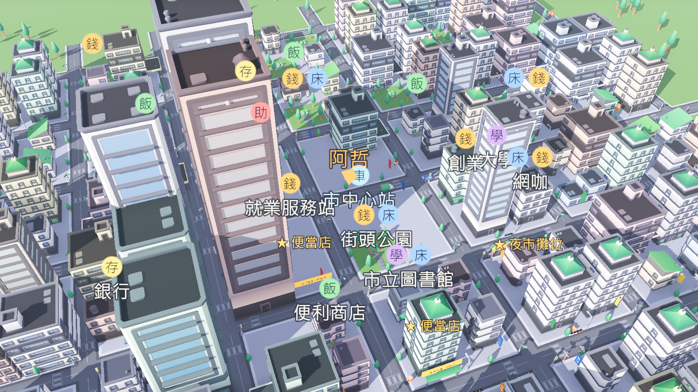
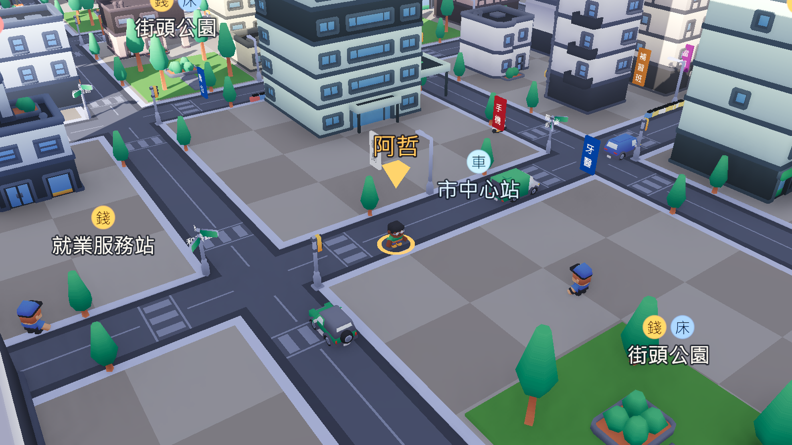
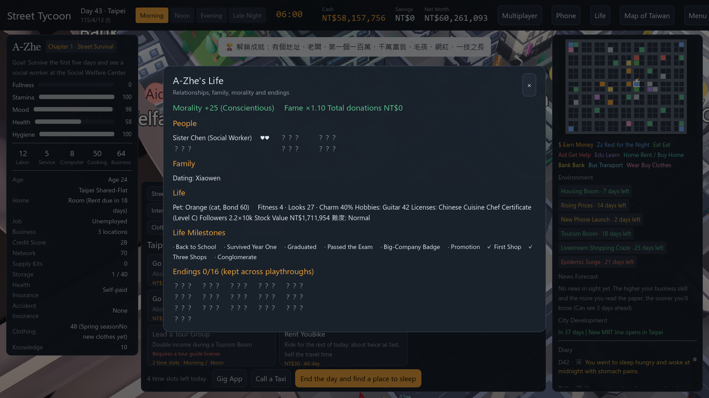
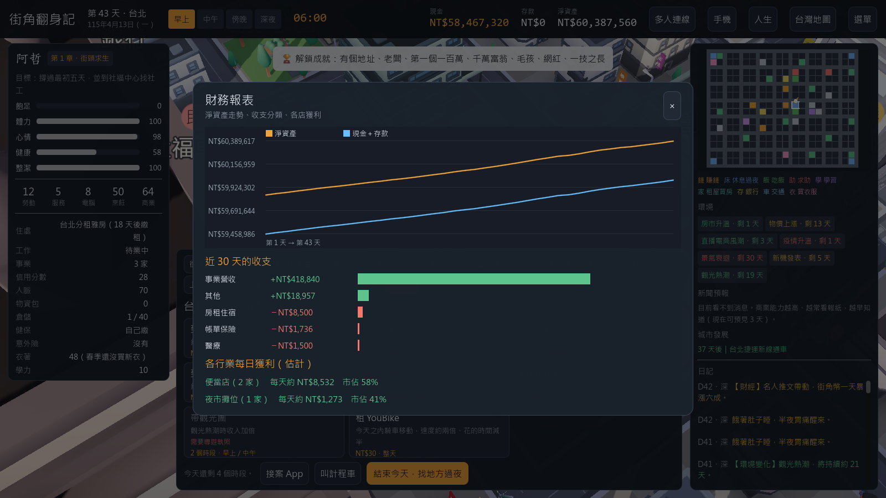

<h1 align="center">街角翻身記 Street Tycoon</h1>

從露宿街頭到身價五千萬：一個失業青年的 3D 人生模擬遊戲 
From sleeping on the street to a NT$50 million fortune — a 3D life-sim about getting back on your feet

<a href="https://github.com/wuling63/street-tycoon-releases/releases/latest"><b>⬇ 下載最新版 Download the latest version</b></a> ·
<a href="docs/GUIDE.zh-TW.md">遊戲說明（中文）</a> ·
<a href="docs/GUIDE.en.md">Player Guide (English)</a>

這個儲存庫只提供遊戲下載與說明，不含原始碼。
This repository hosts downloads and player guides only; it does not contain the source code.

---

## 下載 Download

到 [Releases](https://github.com/wuling63/street-tycoon-releases/releases/latest) 下載你的平台的檔案：
Get the file for your platform from [Releases](https://github.com/wuling63/street-tycoon-releases/releases/latest):

| 平台 Platform | 檔案 File | 安裝 How to install |
|---|---|---|
| **Windows 10/11** | `StreetTycoon_Setup_*.exe` | 雙擊安裝，不需要系統管理員權限。SmartScreen 若出現警告，點「其他資訊 → 仍要執行」。 Run it (no admin rights). If SmartScreen warns, click **More info → Run anyway**. |
| **macOS** 11+ | `StreetTycoon_macOS_*.zip` | 解壓縮後把 App 拖進「應用程式」。第一次開啟請按右鍵 →「打開」（App 沒有經過 Apple 簽章）。 Unzip and drag the app to Applications. The first time, right-click → **Open** (the app isn't signed by Apple). |
| **Linux** x86_64 | `StreetTycoon_Linux_*.tar.gz` | `tar xzf StreetTycoon_Linux_*.tar.gz && ./StreetTycoon/StreetTycoon.x86_64` |
| **Android** 8+ | `StreetTycoon_Android_*.apk` | 在手機上下載後開啟安裝，需要允許「安裝不明來源的應用程式」。 Download on your phone and open it; allow "install unknown apps" when asked. |

**需求 Requirements**：支援 Vulkan 的顯示卡（電腦），或支援 Vulkan 的 Android 手機。
A Vulkan-capable GPU (desktop) or a Vulkan-capable Android phone.

遊戲啟動時會自動檢查有沒有新版本。
The game checks for new versions automatically when it starts.

---

## 這是什麼遊戲 What is it?

二十七歲的阿哲失業了，口袋裡只剩一千兩百元。你要帶著他先活下去，利用社會福利站穩腳步，學技能、找工作、租房子，再看準景氣和新聞開店創業，最後成為大商人，或者走出完全不同的人生。

A-Zhe is 27, just lost their job, and has NT$1,200 left. Survive, get back on track with help from social welfare, learn a skill, find work, rent a home, read the economy to start a business — and become a tycoon, or live a completely different life.

- 可以自由走動的 3D 大都市，有四季和各國不同的節慶 / A walkable 3D city with seasons and country-specific festivals
- 10 個國家、5 種語言（繁中、简中、English、日本語、한국어）/ 10 countries, 5 languages
- 大學與國考、創業與商戰、股市與上市、選舉、法院、詐騙、寵物、網紅、養育子女、包租公 / University, business wars, stocks & IPOs, elections, courts, scams, pets, influencers, raising children, landlording
- 16 種結局、27 個成就、3 個電腦大亨對手 / 16 endings, 27 achievements, 3 AI tycoon rivals
- 區域網路多人連線 / LAN multiplayer
- 11 首約 10 分鐘的配樂 / 11 background tracks of about 10 minutes each

完整說明 Full guide：**[中文](docs/GUIDE.zh-TW.md)** · **[English](docs/GUIDE.en.md)**

---

## 畫面 Screenshots

| | |
|---|---|
|  |  |
|  |  |

---

3D 模型 3D models：[Kenney](https://kenney.nl)（CC0）・音樂與音效由程式合成 / Music & SFX are procedurally generated.
© wuling63
